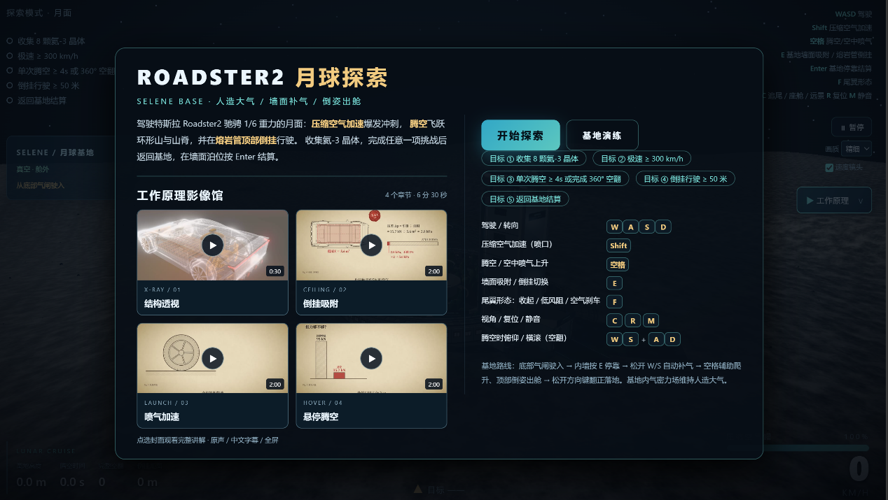
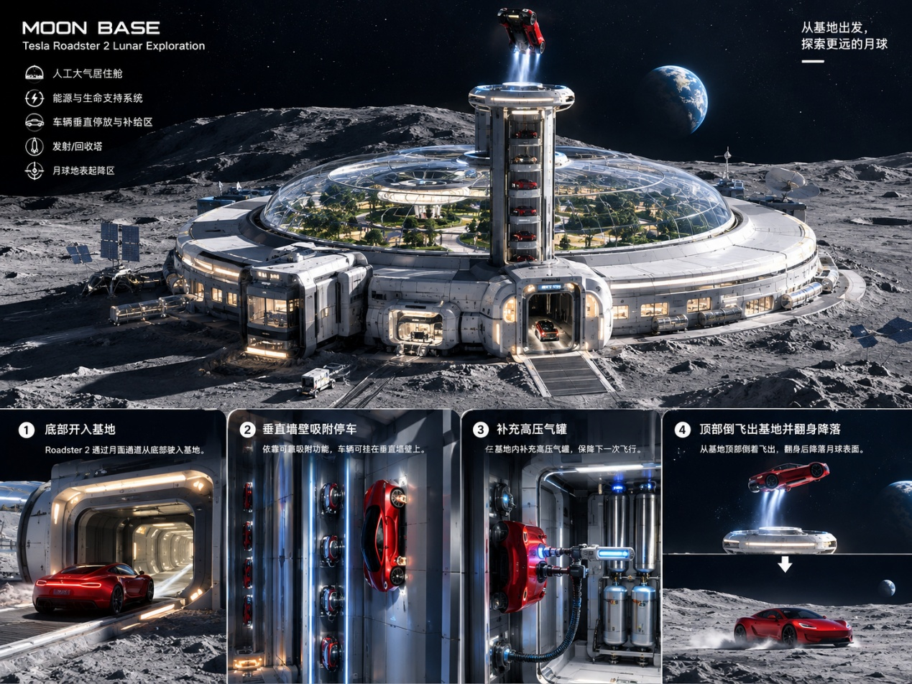
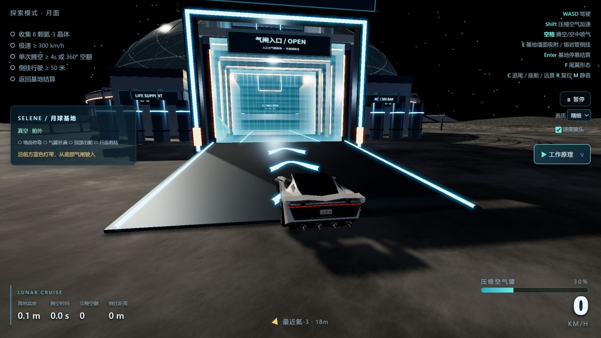

# Roadster2 飞跃月球

驾驶 Roadster2 探索程序化月面，体验压缩空气加速、腾空翻转和倒挂行驶，返回 SELENE 基地停靠补气，再从塔顶倒姿出舱。这是一个用 Three.js 与 WebGL 制作的浏览器科普游戏，也是一段从孩子的好奇心出发、通过 AI 辅助创作完成游戏的亲子实践。

本仓库收录 **v3.2 CloudBase 部署包对应的完整源码与运行资源**，包括车辆模型、月面纹理、四段原理视频和部署输入。网页发布配置已准备；本次源码导入未启用或执行网页部署。



## 项目的起点

《项目说明》记录了这个项目的由来：一位 10 岁小朋友想用“一句话”做出自己的第一款游戏。最终，我们把目标收敛成一个能够实际游玩的小型月球探索项目，从 Roadster2 三维模型入手，逐步完成场景、驾驶、喷气、姿态控制和挑战结算。

最初的创作尝试结合了 DeepSeek 三维建模与豆包的游戏策划、图像和视频能力。实际开发并不是一次提示就结束：车辆穿模、喷口方向、转向、镜头跟随、基地进出舱，都需要在浏览器里反复检查和调整。原理讲解视频则把“怎么操作”连接到“为什么会这样”，让游戏同时成为讨论推力、重力和气压差的入口。

这里的压缩空气推进、保压力场和吸附系统属于概念演示与简化游戏机制。车型名称不代表官方授权；游戏数值也不代表真实车辆的性能承诺或工程验证。

更多过程截图见 [创作记录](docs/creation.md)。

## 可以体验什么

- **月面探索**：多层地形、7 座环形山、山脊与熔岩管，配合星空、动态光影、扬尘和车轮轨迹。月球重力参数为 `1.62 m/s²`。
- **压缩空气加速**：按住 `W + Shift`，尾部喷口提供加速反馈；游戏极速上限约 `396 km/h`，同时消耗气罐。
- **腾空与姿态控制**：空格起跳或喷气上升，空中用 `W/S` 控制俯仰、`A/D` 控制横滚，可完成完整空翻。
- **熔岩管倒挂**：在有效区域按 `E` 切换吸附，贴着管顶行驶；气体耗尽或离开区域后脱离。
- **SELENE 基地**：从底部气闸进入人工大气区，在内墙停靠、补充高压气罐，再沿轨道爬升，从顶部倒姿飞出、翻正落地。
- **工作原理影像馆**：首页封面与游戏内 `V` 入口，按需加载视频；观看时暂停驾驶，关闭后恢复原有状态。

### SELENE 基地

下图是《项目说明》中的基地概念参考图，**不是游戏实时截图**：



当前版本的实际气闸入口：



在首页选择“基地演练”可以直接练习完整流程：

1. 沿蓝色地面箭头按 `W` 驶入底部气闸。
2. 接近内墙后减速，按 `E` 贴墙停靠。
3. 松开 `W/S`，停在泊位自动补气；从空罐充满约需 4.2 秒。
4. 气量达到 25% 后按空格，启动辅助爬升和顶部倒姿出舱。
5. 松开控制键，自动翻正、快速下降并在接地前减速；`WASD`、空格或 `Shift` 可取消下降辅助并手动接管。

月面真空中不能自动回气；舱内可慢充，墙面接口可快充。v3.2 修复了进出基地时的相机跳位，加入平滑跟随与转向速度限制。标准路线的出舱至落地时间约从 17.3 秒缩短到 6.6 秒；普通月面跳跃的重力与控制保持不变。

### 四段原理讲解

| 章节 | 时长 | 内容 |
| --- | --- | --- |
| 结构透视 | 0:30 | 驱动、储罐与推进系统布局 |
| 倒挂吸附 | 2:00 | 有大气环境下的气压差与贴附力 |
| 喷气加速 | 2:00 | 速度、推力与压缩空气辅助加速 |
| 悬停腾空 | 2:00 | 向下喷气与悬停受力平衡 |

视频为完整的 720p H.264/AAC 副本，保留声音及画面原有字幕，总时长 6 分 30 秒、总大小约 29.26 MB。首页仅加载封面，选择章节后才加载对应视频，支持进度控制和全屏。文件位于 [`public/assets/videos`](roadster2-moon-cloudbase/public/assets/videos)。

## 操作

需要支持 WebGL 的现代浏览器，当前主要面向桌面键盘游玩。

| 按键 | 功能 |
| --- | --- |
| `W / S` | 前进 / 后退；空中俯仰；基地墙面升降 |
| `A / D` | 地面转向；空中横滚 |
| `Shift` | 压缩空气加速 |
| `空格` | 起跳 / 空中喷气；基地泊位启动辅助出舱 |
| `E` | 基地墙面吸附或释放；熔岩管倒挂切换 |
| `Enter` | 完成至少一项挑战后，在基地墙面停稳结算 |
| `C` | 追尾 / 座舱 / 远景切换；基地路线使用稳定外部镜头 |
| `F` | 切换尾翼形态 |
| `R` | 复位 / 重开 |
| `M` | 游戏音效静音 |
| `V` | 打开工作原理影像馆 |
| `Esc` | 暂停游戏；关闭影像馆 |

## 挑战与单局循环

| 挑战 | 达成条件 |
| --- | --- |
| 氦-3 收集 | 收集 8 颗晶体 |
| 极速冲刺 | 达到 300 km/h |
| 腾空 / 空翻 | 单次腾空至少 4 秒，或完成一次完整 360° 空翻 |
| 倒挂行驶 | 累计倒挂至少 50 米 |
| 返回基地 | 完成至少一项挑战，在墙面泊位停稳后按 `Enter` |

HUD 显示挑战进度、气罐余量、离地高度和飞行状态。结算结合晶体、极速、最长腾空、倒挂距离及返航得分给出 C～SSS 评级。游戏采用“探索 → 挑战 → 返航补气 → 结算 → 重开”的单局循环。

## 本地运行

使用 **Node.js 22.18.0 与 npm**，版本记录在项目的 `.node-version` 中。

```bash
git clone https://github.com/wangxingweiwxw/Roadster2onMoon.git
cd Roadster2onMoon/roadster2-moon-cloudbase
npm ci
npx vite --host 127.0.0.1
```

打开终端显示的本地地址。请通过 HTTP/HTTPS 访问，不要直接双击 `index.html`。

构建和预览：

```bash
npm run build
npx vite preview --host 127.0.0.1
```

输出目录是 `roadster2-moon-cloudbase/dist/`。该目录只包含可发布的网页资源，README 配图和创作记录不会进入网页构建产物。

在仓库根目录运行回归测试：

```bash
node tests/run.js
node scripts/check-assets.mjs
```

测试覆盖左右转向、喷气耗气、空翻判定、倒挂、基地停靠补气、快速落地，以及 30 / 60 / 120 帧率下三种镜头选择的基地路线连续性。

## 后续网页部署

### GitHub Pages

仓库提供 [`Deploy GitHub Pages`](.github/workflows/deploy-pages.yml) 工作流，**仅支持手动触发**，普通 push 不会发布网站。

1. 在仓库 **Settings → Pages → Build and deployment** 中，把 Source 设为 **GitHub Actions**。
2. 在 **Actions → Deploy GitHub Pages → Run workflow** 中选择 `main` 并执行。
3. 成功后在该次 workflow 的 deployment 输出中查看实际网址。

工作流会安装依赖、运行回归检查、构建并发布 `dist/`。现有 `base: './'` 使用相对资源路径，适合项目子路径托管；原生 ESM、GLB、纹理和视频保留在同一静态目录中。准备阶段没有设置自定义域名，也没有启用自动发布。

参考：[GitHub Pages 自定义工作流](https://docs.github.com/en/pages/getting-started-with-github-pages/using-custom-workflows-with-github-pages)、[Vite 相对路径构建](https://vite.dev/guide/build.html#relative-base)。

### CloudBase / 知乎 AI Works

[`roadster2-moon-cloudbase/_tmp/`](roadster2-moon-cloudbase/_tmp) 保留对应部署包的计划、前端描述符、埋点 ticket 物化脚本及 Agent 信息。该目录虽然名为 `_tmp`，其中这些文件是正式部署输入，不能全部忽略。

原有流水线入口是 `npm ci` → `npm run build:track` → 发布 `dist/`。`build:track` 会在正式构建时处理平台提供的 `AIWORKS_EVENT_TRACKING_TICKET`；源码中只有占位符，没有真实 ticket。未注入 ticket 时，事件桥不会发送追踪请求，普通静态部署可直接使用 `npm run build`。

本次导入依据的已验证 ZIP 为 **37,657,233 字节（约 37.66 MB）**，低于 50 MB 上限。ZIP 本身不提交到 Git；完整来源及逐文件 SHA-256 见 [部署来源记录](docs/deployment-source.json)。以后修改项目，应重新使用 AI Works Skill 探测、生成描述符、校验与打包，不能把历史计划视为已验证的新部署包。

## 项目结构

```text
Roadster2onMoon/
├── README.md
├── LICENSE                         # 原仓库 MIT 许可证
├── docs/                           # 项目说明配图、创作记录、部署来源
├── tests/                          # 可直接运行的物理与镜头回归测试
├── scripts/check-assets.mjs         # 静态资源与文档引用检查
├── .github/workflows/              # 自动检查与手动网页发布
└── roadster2-moon-cloudbase/
    ├── index.html / entry.js        # Vite 页面入口
    ├── package.json / package-lock.json
    ├── vite.config.js              # 相对路径，输出 dist
    ├── public/
    │   ├── game.js                 # 游戏流程、输入、HUD、音效
    │   ├── src/                    # 车辆、基地、镜头、特效、影像馆
    │   ├── lib/                    # 本地 Three.js r160 及加载器
    │   └── assets/                 # Roadster2 GLB、纹理、视频及封面
    ├── licenses/                   # 第三方许可证与模型来源代码
    └── _tmp/                       # AI Works 部署输入
```

游戏使用原生 JavaScript ESM、Three.js r160 与 WebGL；Vite 负责构建入口并复制静态资源。车辆物理按 120 Hz 固定步长更新。核心数值见 [`config.js`](roadster2-moon-cloudbase/public/src/config.js)，基地布局见 [`base-layout.js`](roadster2-moon-cloudbase/public/src/base-layout.js)。

## 许可与素材来源

保留原仓库的 [MIT License](LICENSE)。**此许可不覆盖已经声明为其他许可的文件和第三方素材**：基于 openracing 的游戏、物理与特效代码、基地源码和模型资产按现有说明遵循 MPL-2.0；Three.js 及相关加载器遵循 MIT。具体范围与来源见 [THIRD_PARTY_NOTICES.txt](roadster2-moon-cloudbase/THIRD_PARTY_NOTICES.txt) 和 [licenses](roadster2-moon-cloudbase/licenses)。

文档配图来自项目作者提供的《项目说明.docx》与项目运行截图，原理视频来自作者提供的四段 MP4；不因仓库根目录存在 MIT 许可证而额外推定这些素材的授权范围。配图来源见 [图片说明](docs/images/README.md)。本项目为非官方游戏演示，与 Tesla 无隶属或背书关系。
