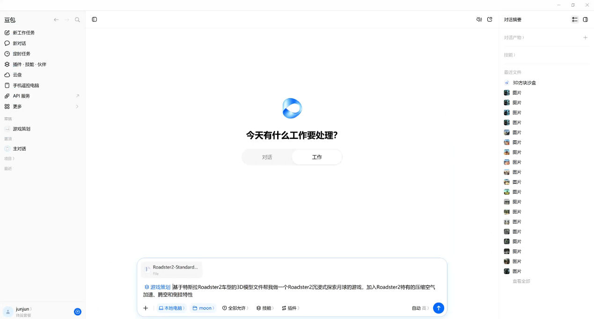
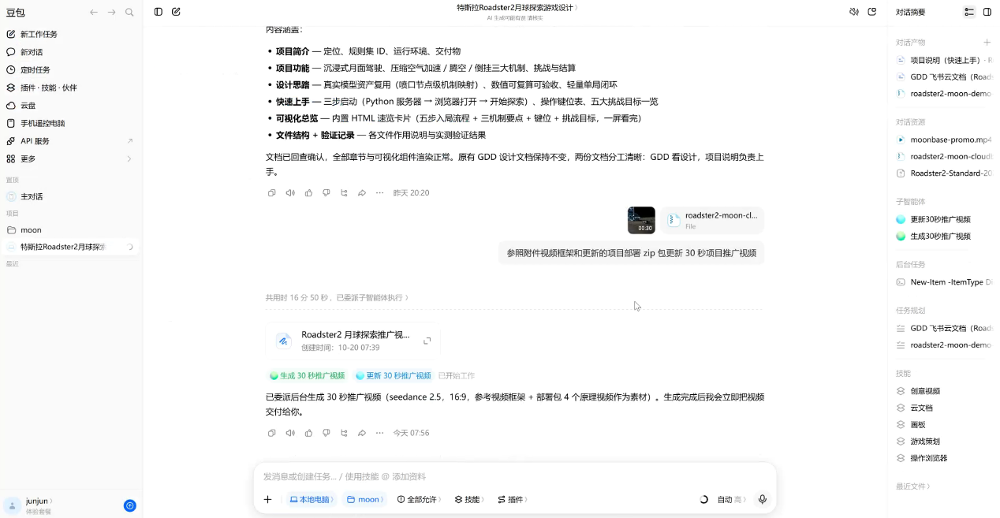

# 从想法到月球探索游戏

本文根据项目作者提供的《项目说明.docx》整理。最初的目标是陪孩子制作自己的第一款游戏：以 Roadster2 三维模型为起点，把压缩空气推进、腾空与倒挂转化为可操作、可观察的机制。

## 从模型和玩法开始

作者在最初的尝试中，将三维模型文件交给游戏策划工具，描述希望实现的月球探索玩法。项目随后逐步补充车辆控制、地形、喷气特效和任务目标。

## 用概念图明确基地路线

基地概念图帮助明确了“底部驶入 → 墙面停车补气 → 顶部倒姿出舱 → 翻正落地”的体验。实际游戏采用程序化几何、人工大气区和吸附轨道实现这一流程。

## 反复试玩和修改

《项目说明》特别提到，车辆与地面的穿模、喷口效果、空中姿态都需要迭代。后续版本继续修复了转向、镜头突变和进出基地体验。当前仓库同时保留可读源码与回归测试，便于接着修改、复现与学习。

原说明中的结算方式与部分喷口编号描述属于早期版本。仓库首页按 v3.2 实现更新：结算需在基地墙面泊位停稳后按 Enter，完整操作以游戏内提示为准。

## 把讲解放进游戏

原理视频让玩家可以在驾驶之外观察车辆结构、理解推力与受力。作者也尝试了根据游戏资料制作推广视频；下图是该创作流程的记录，不代表仓库额外包含推广成片。

文档里关于套餐额度消耗、工具效果的描述属于作者当时的一次使用体验，没有作为当前价格或能力保证写入操作说明。
